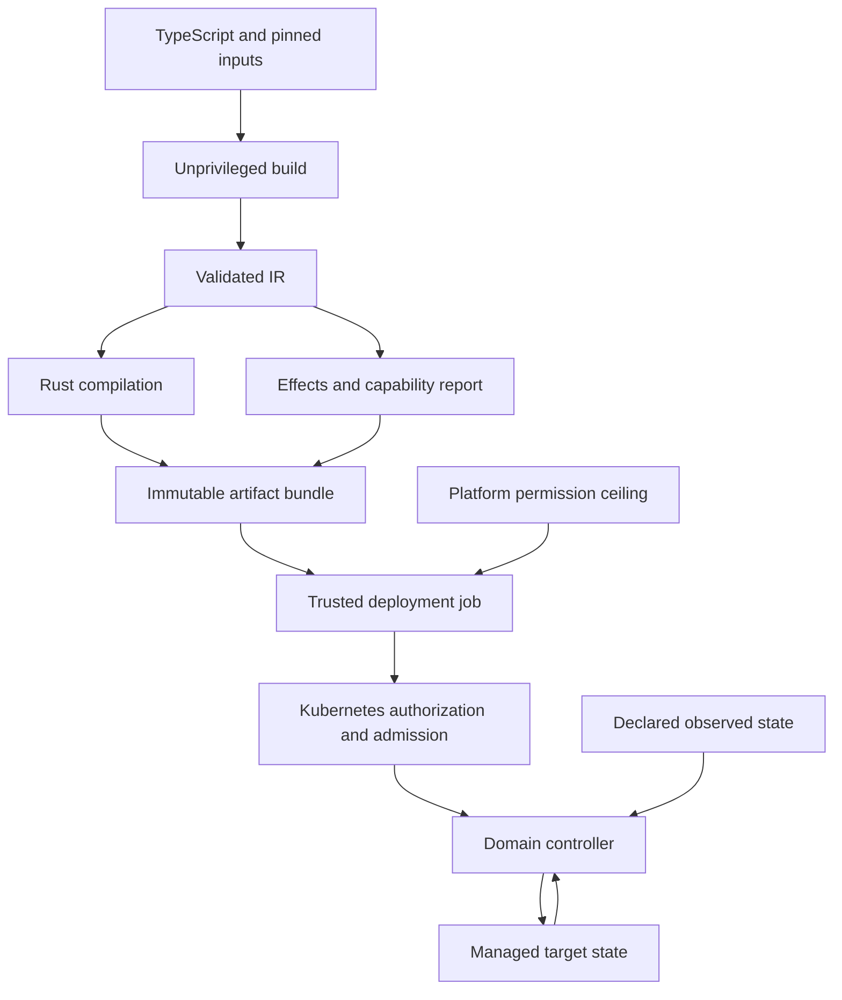
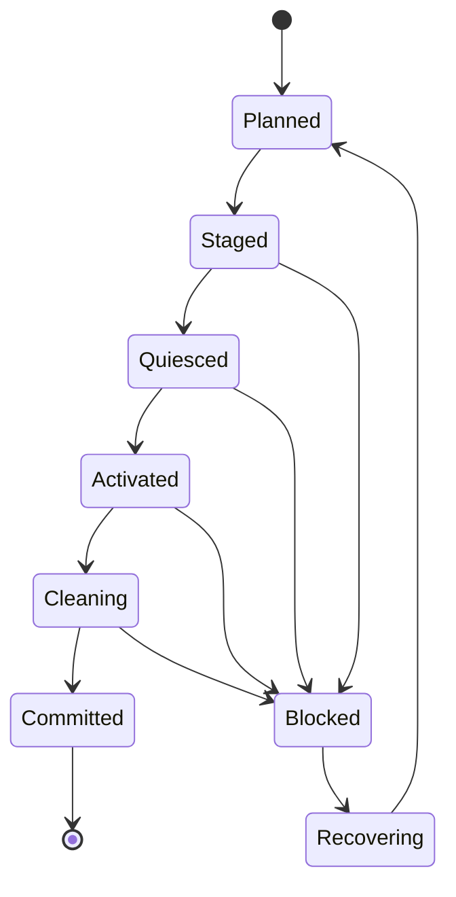

Specification: Compiled Reactive GitOps

Version: 0.3
Status: Proposed architecture and implementation contract
Date: 25 September 2026

This specification defines required behaviour, security limits, implementation scope, and acceptance criteria. Code examples define the required DSL shape; the current implementation boundary is documented separately. Requirements marked as future work do not belong to the initial release.

## 1. Overview

Compiled Reactive GitOps compiles declarative infrastructure programs into purpose-built Kubernetes controllers. Each controller continuously reconciles a defined domain, evaluates a statically declared set of infrastructure reactions, and runs a statically declared set of sandboxed event handlers.

The architecture has three operational stages:

1. Build: evaluate TypeScript without deployment credentials, validate a constrained intermediate representation, derive effects and API requirements, and compile a Rust controller.
2. Deployment: a trusted deployment job verifies the artifact, checks independently controlled policy, obtains short-lived credentials, and installs or upgrades the controller through a resumable protocol.
3. Runtime: the controller reconciles continuously using a dedicated Kubernetes identity whose authority is constrained by authorization and applicable admission policies.

The core security proposition is:

> Compilation makes intended effects and required permissions explicit and auditable. Kubernetes authorization and independently administered admission policies enforce runtime boundaries. Short-lived deployment credentials reduce credential exposure, while deployment authorization remains a separate trust boundary.

Compilation alone does not make a Kubernetes credential capable of executing only the generated program. A compromised controller can exercise the authority its credential actually receives.

The system MUST NOT require a permanently running project component with cluster-admin. Initial bootstrap and permission-ceiling changes MAY require platform administration. The corresponding authorization and identity-provider trust configuration remain installed even when no deployment credential is currently active.

## 2. Terminology and normative language

MUST and MUST NOT identify mandatory requirements. SHOULD identifies a recommended default for which an implementation must document exceptions. MAY identifies optional behaviour.

|Term              |Meaning                                                                                                    |
|------------------|-----------------------------------------------------------------------------------------------------------|
|Program           |Source definitions and their declared build inputs.                                                        |
|IR                |Versioned, validated intermediate representation of resources, inputs, computations, effects, and policies.|
|Domain            |An explicit unit of reconciliation, ownership, authorization, and deployment.                              |
|Build             |An immutable compiler output identified by content digests.                                                |
|Generation        |A deployment activation of a build in a particular domain and cluster.                                     |
|Effect            |An intended mutation, including its targets, writable fields, and value constraints.                       |
|API capability    |An authorized Kubernetes request scope: API resource, subresource, verb, namespace, and applicable names.  |
|Input projection  |The selected, typed fields of a declared input used by a computation.                                      |
|Reaction          |A constrained computation contributing desired state to one or more declared targets.                      |
|Event handler     |A build-time-bundled module export the controller runs in a sandbox when a declared input changes.         |
|Handler output    |A managed ConfigMap whose data only its one declared writer handler supplies.                              |
|Egress host       |A DNS name and port a handler may reach over HTTPS, declared at build time.                                |
|Inventory         |Durable records of managed identities, observed UIDs, lifecycle decisions, and transition progress.        |
|Permission ceiling|Platform-owned policy limiting the authority a domain may receive.                                         |

Build identity and generation identity MUST be distinct. Reusing an older build during rollback creates a new generation; it does not reactivate an old generation identity.

## 3. Goals and scope

The system MUST provide:

- TypeScript composition, reusable packages, schema validation, and a finite IR.
- Compilation into Rust controllers with a constrained runtime effect vocabulary.
- Explicit domains, source provenance, ownership, and field-management contracts.
- Capability derivation from the actual generated runtime request plan.
- Policy-checked deployment using short-lived credentials.
- Continuous drift correction and declarative infrastructure reactions.
- Declared event handlers with fixed inputs, outputs and HTTPS egress, run in a resource-limited sandbox (section 17.1).
- Recovery from missed notifications, restarts, retries, and watch expiration.
- Explicit adoption, deletion, orphaning, upgrade, and rollback semantics.
- Reviewable resource, reaction, permission, and lifecycle changes.
- Reproducible build inputs and verifiable artifact identity.
- Compiler-generated reactor tests with synthetic external resources and self-contained workload images.

The architecture MUST support repositories that emit one or several domains. A domain MAY span several namespaces in a later implementation. One controller per application is not required. Domains SHOULD align with trust boundaries; a single organisation-wide domain deliberately combines the authority of its contents.

The initial release MUST NOT provide shell hooks, dynamic plugins, general workflow execution, business-event processing, automated database failover, runtime RBAC administration, or arbitrary runtime target creation. Runtime TypeScript is limited to declared event handlers: modules fixed at build time, compiled into the controller image, and restricted to their declared inputs, outputs and egress hosts. Handlers receive no Kubernetes credential and cannot create targets or read Secrets.

The initial release supports fixed names within one workload namespace per domain. This is an implementation boundary, not a restriction on the long-term domain model.

## 4. System architecture



The Rust compiler MAY share an audited runtime library across generated binaries. It SHOULD specialize resource plans, projections, indexes, and reaction code where beneficial. It MUST NOT require source checkout, package installation, source evaluation, or arbitrary code loading inside reconciliation loops. Event handler bundles are produced at build time, embedded in the controller binary, and checked against the digests the validated IR records before the controller starts; the controller loads no other code.

New effects, watched API types, handlers, egress hosts, or authorization scopes require a new build and deployment. Changes to already declared external input values do not require a rebuild.

## 5. Threat model and enforcement profiles

The design distinguishes four failure or compromise cases:

|Case                                                        |Required response or boundary                                                                                    |
|------------------------------------------------------------|-----------------------------------------------------------------------------------------------------------------|
|Incorrect source or generated plan                          |Compiler checks, policy validation, conflict detection, and bounded runtime behaviour.                           |
|Malicious source dependency                                 |Isolated build execution; no access to deployment credentials; deployment verifies approved artifacts and policy.|
|Compromised runtime or stolen token                         |Kubernetes authorization and independently enforced admission constraints define the reachable authority.        |
|Compromised trusted deployment job or platform administrator|Potential durable changes within that identity’s authority; credential expiry does not reverse them.             |

The compiler, code generator, runtime library, trusted deployment job, and relevant enforcement components belong to the trusted computing base. An IR becomes a checked boundary only when all accepted operations and their effects are validated. Merely serializing a program into JSON provides no security guarantee.

### 5.1 API-bound profile

This is the initial release profile. Every domain MUST declare its workload scope and receive explicit API permissions. The report MUST disclose any granted authority broader than its intended effects.

For example, an intended rollout can require patch permission on a named Deployment. That permission is not itself restricted to a rollout annotation. Workload mutations can also expose mounted data and service-account authority. The platform policy MUST account for those indirect privileges. Kubernetes RBAC security guidance

Platform-managed admission rules SHOULD constrain permitted service accounts, secret references, workload security settings, images, and other locally sensitive choices. The domain controller MUST NOT be able to modify the policies or bindings that enforce its boundary.

### 5.2 Effect-bound profile

A later profile MAY enforce specific target fields and output constraints against the runtime identity using independently protected admission controls. It MUST define coverage for create, update, patch, delete, applicable subresources, ownership metadata, and generation changes.

A requested constraint MUST either be enforced by a verified mechanism or rejected as unsupported. An implementation MUST NOT silently downgrade an effect-bound request to the API-bound profile. Write admission does not narrow read authority.

## 6. Deployment authorization and build isolation

The build stage MUST evaluate source and dependencies without Kubernetes deployment credentials, privileged cloud credentials, or access to the trusted deployment job’s execution environment. Declared build-only credentials, if unavoidable, require a separate documented policy and MUST NOT be embedded in artifacts.

The trusted deployment job MUST:

1. Verify the immutable bundle digest and approved build provenance.
2. Validate the IR and capability manifest with a trusted, pinned validator.
3. Check requested permissions, indirect risks, and enforcement gaps against a platform-owned ceiling.
4. Verify that the controller image, IR, reports, and deployment metadata belong to the same build.
5. Obtain an identity-bound, short-lived credential only for deployment work.
6. Execute the transition plan and persist progress.

Signature verification establishes provenance, not semantic correctness. A trusted build pipeline and validator remain necessary. The deployment job MUST NOT execute project-provided scripts as privileged deployment hooks.

OIDC integration MUST verify issuer, audience, subject, and the supported repository, workflow, ref, or environment restrictions required by platform policy. Claim formats and provider mappings MUST be validated for the selected integration; a GitHub OIDC token is not automatically a Kubernetes credential. GitHub OIDC reference

Routine deployment credentials SHOULD be scoped to the domain and required coordination objects. Increasing a permission ceiling is a separate platform change. Kubernetes requires a deployer to possess the rights it grants or hold the relevant escalation/binding permissions; arbitrary RBAC creation MUST NOT be assumed to bypass that check. Kubernetes RBAC bootstrapping

Runtime controllers MUST NOT manage their own Deployment, ServiceAccount, RBAC, enforcement policies, or activation authority. Controller workloads and sensitive control state SHOULD reside outside the workload namespace they manage. Permitted workload service accounts MUST exclude identities that can administer those control resources.

## 7. Domain and repository model

A repository explicitly declares its domains. Repository boundaries do not automatically define runtime trust boundaries.

Each domain MUST have:

- A stable platform-assigned domain identifier and cluster binding.
- Allowed workload namespaces and API scope.
- A platform policy reference and enforced policy digest.
- Separate runtime identities for successive generations.
- Stable field-manager identity across builds.
- Ownership claims, inventory, and transition records.
- Resource and event-processing budgets.

The compiler MUST detect overlapping declarations within its complete input. Deployment MUST check independently compiled domains against the ownership registry before activation.

Cross-domain observations MAY be introduced with explicit read authorization. A reaction does not acquire write authority over another domain merely because it names a target. Cross-domain mutation requires an explicit ownership or field-management contract and is deferred from v1.

## 8. TypeScript authoring

TypeScript runs during the build to construct declarations. Functions, loops, package composition, and organisational abstractions are allowed at this stage. Runtime decisions MUST be represented using typed IR expressions and approved primitives.

Illustrative v1 authoring:

```tsx
import {
  ConfigMap,
  Controller,
  Deployment,
  Service,
  useConfigMap,
  useResourceRef,
  useSecret,
} from "@apsides/kubernetes";

const Api = ({ name, namespace }: { name: string; namespace: string }) => {
  const config = useResourceRef("ConfigMap");
  const settings = useConfigMap({ name: "external-settings" });
  const credentials = useSecret({ name: "database-credentials" });

  return (
    <>
      <ConfigMap
        ref={config}
        metadata={{ name: `${name}-config`, namespace }}
        data={{ LOG_LEVEL: "info" }}
        deletionPolicy="orphan"
      />
      <Deployment
        metadata={{ name, namespace }}
        deletionPolicy="orphan"
        rolloutOn={[config.data, settings.data, credentials.data]}
        spec={{
          replicas: 3,
          selector: { matchLabels: { app: name } },
          template: {
            metadata: { labels: { app: name } },
            spec: {
              containers: [{
                name,
                image: "registry.example.com/api:1.0.0",
                ports: [{ containerPort: 8080 }],
                envFrom: [
                  { configMapRef: { name: `${name}-config` } },
                  { secretRef: { name: "database-credentials" } },
                ],
              }],
            },
          },
        }}
      />
      <Service
        metadata={{ name, namespace }}
        deletionPolicy="orphan"
        spec={{ selector: { app: name }, ports: [{ port: 80, targetPort: 8080 }] }}
      />
    </>
  );
};

export default (
  <Controller
    id="team-api-production"
    namespace="production"
    controlNamespace="apsides-system"
    clusterBinding="local-fixture"
    policyRef="platform/team-api"
    enforcement="api-bound"
  >
    <Api name="api" namespace="production" />
  </Controller>
);
```

Image tags above are illustrative. Production policy SHOULD require immutable workload image references; controller artifacts MUST be deployed by digest. The referenced workload ServiceAccount is an external platform prerequisite in this example.

Resource elements such as `ConfigMap`, `Deployment`, and `Service` grant lifecycle intent only for the declared object and fields. Observation hooks such as `useConfigMap` and `useSecret` grant no mutation intent. There is no generic runtime callback escape hatch.

Event handlers are declared with the `On` element and a handler output with `useHandlerOutput`:

```tsx
const settings = useConfigMap({ id: "feature-settings", name: "feature-settings" });
const flags = useHandlerOutput({ id: "resolved-flags", name: "resolved-flags" });

<On
  id="resolve-flags"
  trigger={settings.changed}
  handler="./handlers/resolve-flags.ts#resolveFlags"
  inputs={[settings]}
  egress={["flags.example.com"]}
  outputs={[flags]}
/>
<Deployment metadata={{ name: "api", namespace }} rolloutOn={[flags.data]} spec={apiSpec} />
```

`handler` MUST be a module reference string, never a function: the module runs in a separate sandbox and cannot capture build-time closures or values. The module MUST be part of the locked source closure and MAY import only other locked modules, plus erased type-only imports of the SDK's handler declarations. The compiler MUST type-check every handler module in strict mode against the ECMAScript library and those declarations only, so a handler that uses a global the sandbox does not provide fails the build. `useHandlerOutput` declares a managed ConfigMap that only its handler writes; its `.data` projection MAY feed `rolloutOn` like any other input projection. An `On` element grants no Kubernetes authority beyond the named reads and output writes the compiler derives from it.

## 9. Intermediate representation

The IR MUST be versioned, canonicalizable, and reject unknown operations. It MUST include:

|Element      |Required information                                                                                |
|-------------|----------------------------------------------------------------------------------------------------|
|Domain       |Stable identity, target scope, enforcement request, policy reference.                               |
|Resource     |API identity, fixed name, namespace, desired fields, lifecycle policy.                              |
|Ownership    |Lifecycle owner, field sets, adoption intent.                                                       |
|Input        |Source identity, projection, sensitivity, missing-input policy.                                     |
|Computation  |Typed expression, input dependencies, bounded evaluation cost.                                      |
|Effect       |Target, field paths, operation, permitted value shape, source location.                             |
|Dependency   |Creation prerequisite, readiness predicate, or data dependency.                                     |
|Reaction     |Input projections, contribution to desired state, stable identity.                                  |
|Handler      |Module and export, bundle digest, trigger input, inputs, egress hosts, outputs, time and heap limits.|
|Output       |Identity of a handler-written managed ConfigMap and its single writer.                              |
|Runtime plan |Request strategy, watches, queues, indexes, state requirements.                                     |
|Test contract|Fixture requirements, supported stimuli, expected primitive invariants, and test-only substitutions.|
|Provenance   |Source map, dependency digests, schemas, compiler configuration.                                    |

The compiler MUST recompute effects and permissions from validated operations; it MUST NOT trust an author-supplied permission summary. Raw HTTP, arbitrary API paths, unbounded recursion, dynamic code, and opaque side effects MUST be rejected in resource, input and reaction declarations. A handler is the only declaration that carries code; its reachable network is its declared egress list and its only writable state is its declared outputs, both part of the reviewed IR.

A finite IR does not imply a fixed runtime object set. V1 MUST reject runtime-derived target names and namespaces. Future template instantiation requires separate bounds for allowed namespaces, names, cardinality, cleanup, and indirect privileges.

Runtime-observed data MUST NOT select additional API permissions, identities, egress hosts, or undeclared mutation targets. Sensitive inputs MUST retain their classification through derived expressions. Handler inputs MUST be non-sensitive; Secret inputs cannot be passed to a handler.

## 10. Effective desired state and source precedence

For each managed target, the controller computes one effective desired representation:

```text
desired(target) = compose(compiledBase(target), declaredContributions(inputs))
```

compose MUST be deterministic. The compiler MUST reject overlapping writers unless a supported merge rule defines an unambiguous result. Base reconciliation and reactions MUST NOT issue competing writes to the same fields.

Each field has an explicit source category:

|Category            |Authority                                                               |
|--------------------|------------------------------------------------------------------------|
|Compiled field      |Value supplied by the approved build.                                   |
|Derived field       |Deterministic function of declared inputs.                              |
|Delegated field     |Managed by a named external contract, such as HPA ownership of replicas.|
|Server-managed field|Excluded from the controller’s desired writes.                          |
|Handler-written data|`data` of a handler output, written only by its declared handler.       |

For a managed ConfigMap, compiled data is authoritative. An out-of-band edit is drift, not an accepted new configuration revision. Dependent rollout computation MUST use the authoritative desired projection and wait until the corresponding source application succeeds. Persistent external interference is reported as non-convergence.

A handler output's desired state carries only its identity and reserved label; the reconciler never writes its `data`. The handler's written keys are observed live through the output's own input and MAY contribute rollout revisions like observed data.

For an observed ConfigMap or Secret, current external data is an authorized input. Its writers can influence the declared reactions, which MUST be disclosed in the capability report. This does not authorize arbitrary target selection.

An effective state may differ from compiled literals only through declared input bindings. Operational changes outside these bindings are drift. The controller MUST expose the build identity and a non-sensitive explanation of the inputs contributing to current desired state.

## 11. Reaction semantics and watch recovery

Reactions MUST be level-based and idempotent: repeated evaluation with unchanged relevant inputs and converged targets performs no further mutation. Notifications schedule evaluation; they are not authoritative event history.

Kubernetes watch history can expire, requiring a relist. Implementations MUST recover from that condition without assuming that every intermediate transition was delivered. Kubernetes API concepts

The runtime MUST:

1. Establish initial state for required inputs before evaluating dependent effects.
2. Enqueue applicable targets on startup and successful relist.
3. Coalesce repeated notifications in bounded queues keyed by target.
4. Recompute from current available projections when processing a target.
5. Compare desired and observed managed fields before writing.
6. Retry transient failures with bounded exponential backoff and jitter.
7. Recover watches using supported resource-version semantics.
8. Perform bounded periodic reevaluation as a recovery mechanism.

Resource versions are opaque continuity tokens, not cross-object sequence numbers. V1 does not promise an atomic snapshot across multiple resources. Each computation uses a recorded set of current cached input versions; subsequent changes trigger reevaluation. Multi-resource transactional consistency requires an explicit external protocol and is outside v1.

changed("data") MAY be syntactic sugar for projection invalidation. It MUST NOT mean execute once per historical transition. created() is excluded from v1; future bootstrap semantics MUST include currently matching objects found at startup.

The runtime MUST distinguish unavailable, absent, invalid, and unauthorized inputs. The default for a missing required input is to block dependent mutations, preserve existing targets, and publish a degraded condition. Input disappearance MUST NOT implicitly delete targets or initiate failover. Optional defaults require explicit declarations.

## 12. Rollout primitive and sensitive inputs

rollout(target) contributes a stable revision annotation to the target’s Pod template. A Deployment rollout occurs when its Pod template changes; merely reapplying an unchanged Deployment is insufficient. Kubernetes Deployments

The compiler MUST combine all rollout dependencies for a target into one canonical revision computation. Input ordering MUST be stable. Relevant content changes produce a new revision; metadata-only changes and repeated evaluation MUST NOT do so.

For non-sensitive ConfigMap data, a canonical content digest is sufficient. V1 Secret handling MUST use a keyed digest or an equivalent reviewed mechanism rather than publishing a plain hash of low-entropy secret values.

For the keyed approach:

- CI provisions a random domain key in protected control storage without including it in source or build outputs.
- Successive generations reuse the key so upgrades do not create spurious revisions.
- The revision includes a key identifier and stable reaction/input identities.
- Key loss or rotation is an explicit operational transition and may cause a rollout.
- Secret values, keys, and sensitive projections MUST NOT enter logs, metrics, plans, or inventory.
- The report MUST disclose access to the input Secret and the control key, plus the fact that observers can detect revision changes.

This mechanism prevents an unkeyed offline guessing oracle from the annotation; it does not conceal data from a controller already authorized to read it. If multiple input changes are coalesced, the controller converges to the latest revision and does not promise a rollout for every intermediate value.

## 13. Graph analysis and convergence limits

The compiler MUST retain separate relations for dataflow, reaction effects, ownership, and readiness prerequisites. A readiness dependency is not equivalent to an instruction to mutate a downstream object.

Within its declared model, the compiler MUST detect:

- Unresolved references and unavailable field projections.
- Incompatible field writers and lifecycle owners.
- Explicit reaction feedback cycles.
- Handler feedback cycles, where a handler's output reaches its own inputs directly or through other handlers.
- Cyclic readiness prerequisites.
- Unbounded or unsupported computations and target derivation.
- Effects outside domain policy or unsupported enforcement requests.

V1 MUST reject declared reaction cycles. This is a conservative language restriction, not a proof of global termination. External controllers, webhooks, and actors can introduce feedback absent from the IR. HPA-managed replicas, for example, MUST be delegated rather than continually restored by the generated controller.

The runtime MUST bound retries and mutation rates, expose persistent conflicts, and identify recurring changes that prevent convergence. Rate limiting MUST not be presented as a correctness proof. A stable external environment and compatible writers are conditions of the eventual-convergence contract.

## 14. Ownership, adoption, and field management

Every mutation target MUST have an explicit lifecycle owner and field contract. Identity is (cluster, API group, resource, namespace, name); API version is tracked for access and compatibility, not used to create a second ownership identity for the same object.

Ownership metadata is provenance, not authorization. In the API-bound profile, runtime ownership checks prevent cooperative mistakes but do not constrain a stolen token beyond API enforcement.

The controller MUST use a stable field-manager name across generations. Handler output writes MUST use a separate stable field manager, so handler-written keys and reconciler-written fields never share ownership. It MUST omit delegated and server-managed fields from its apply representation. Conflicts default to a blocked reconciliation with diagnostics. Adoption or forced ownership requires a separately authorized transition plan, never a blanket runtime force option. Server-Side Apply supplies field tracking and conflict handling. Server-Side Apply

V1 ownership coordination MUST use a protected, platform-provisioned registry per workload namespace. Trusted deployment jobs reserve resource keys atomically using conditional updates. Runtime identities MUST NOT write the registry. A reservation records its domain, transition identifier, and state. Stale reservations require recovery of the owning transition, not blind expiry-based takeover.

Pre-existing objects MUST cause a conflict unless the deployment includes explicit adoption. Adoption records the observed UID, permitted field changes, prior manager conflicts, and lifecycle policy. Ownership transfer between domains is not supported by this implementation; a future transfer design would need to suspend the old owner and update claims before the new owner writes.

Use labels for compact stable identifiers and annotations for source paths and full digests. Values such as apps/api.ts and sha256:... are unsuitable label values. Kubernetes label syntax

```yaml
metadata:
  labels:
    gitops.example.io/domain: team-api-production
  annotations:
    gitops.example.io/source: apps/api.ts
    gitops.example.io/build: "sha256:<full-digest>"
```

Ownership MUST NOT depend on the lifetime of a controller Pod or Deployment. Their deletion or replacement must not garbage-collect the managed workloads through accidental owner-reference chains.

## 15. Capability derivation

The compiler MUST derive permissions from the selected runtime operations, including support operations. manage MUST NOT expand automatically into every Kubernetes verb.

The report MUST separately enumerate:

- Declared reads and effects, with source locations.
- Declared event handlers, their triggers, inputs and outputs, and every egress host and port each handler may reach.
- Actual runtime authorization rules.
- Control-state, rollout-key, and optional leader-election requirements.
- Deployment and transition-cleanup permissions.
- API-enforcement gaps and indirect privilege risks.
- Required external admission controls and verified policy identities.

Capabilities MUST include namespace, resource, subresource, verb, and names where applicable. No wildcards are allowed in v1. Named watches MUST use matching name selectors. Top-level create cannot be restricted by resourceNames; this excess scope requires explicit ceiling acceptance. Kubernetes RBAC

For the chosen apply strategy, request requirements MUST match actual API behaviour. Server-Side Apply requires patch for existing resources and create when creating them. Apply permissions

The compiler MUST NOT broaden read authorization merely to share an informer. A broad Secret watch exposes data, not just notifications. Opaque custom-resource effects MUST be classified as unknown unless a trusted platform contract describes the downstream operator’s authority. Unknown does not mean harmless.

A handler output adds the named read capabilities of its own input and the same apply capabilities as any managed ConfigMap. Egress hosts are not Kubernetes capabilities; they are enforced by the runtime sandbox and MUST be reported alongside permissions.

Risk classification MUST cover workload mutation, Secret access, service-account choice, privileged host access, exec, impersonation, RBAC administration, webhook changes, and other platform-defined escalation paths. Indirect-risk analysis is required from v1, although complete inference over arbitrary operators is not promised.

## 16. Illustrative RBAC and capability report

For a controller that only observes database-credentials and changes an existing Deployment api, workload-side permissions could be:

```yaml
apiVersion: rbac.authorization.k8s.io/v1
kind: Role
metadata:
  name: api-reaction-reader-writer
  namespace: production
rules:
  - apiGroups: [""]
    resources: ["secrets"]
    resourceNames: ["database-credentials"]
    verbs: ["get", "list", "watch"]
  - apiGroups: ["apps"]
    resources: ["deployments"]
    resourceNames: ["api"]
    verbs: ["get", "list", "watch", "patch"]
```

This fragment is not a complete installation: it excludes bindings and separately reported control-state/key access. It does not allow recreating a deleted Deployment. Full management requires separately reviewed create authority.

An associated report MUST make the distinction visible:

```json
{
  "domain": "team-api-production",
  "enforcementProfile": "api-bound",
  "effect": {
    "target": "apps/deployments/production/api",
    "operation": "rollout",
    "writes": ["spec.template.metadata.annotations"]
  },
  "authorization": {
    "resource": "deployments",
    "apiGroup": "apps",
    "namespace": "production",
    "names": ["api"],
    "verbs": ["get", "list", "watch", "patch"]
  },
  "enforcementGaps": [
    "RBAC does not restrict patch to the declared annotation"
  ],
  "indirectRisks": ["workload-template-modification"]
}
```

Permission changes MUST be checked against the platform ceiling even when source review has already approved the program.

## 17. Runtime design and resource handling

The generated binary MUST include only the runtime functions needed for its supported plan, plus health, diagnostics, and recovery facilities. Dead-code elimination is a build optimization, not an authorization control.

V1 MUST use one active controller replica per domain. Within that process, independent targets MAY reconcile concurrently, but each target MUST have serialized writes. Queues, fan-out, request concurrency, and cache memory MUST have explicit budgets.

The controller MUST tolerate API timeouts, conflicts, transient authorization propagation delays, watch disconnects, and process restarts. Persistent permission failures MUST surface as degraded status rather than trigger privilege expansion.

Immutable-field differences MUST produce a clear blocked plan. V1 MUST NOT silently delete and recreate an object to resolve such a difference. Resource replacement requires an explicit lifecycle transition.

A missing managed object is recreated only when creation is authorized and its desired state is evaluable. A missing required input blocks dependent changes. Stable field projections MUST exclude irrelevant metadata and other controllers’ status updates from unnecessary reconciliation.

The controller process MUST read every file it needs during a synchronous startup phase, then restrict itself before any other thread exists. The implementation reads its startup configuration, credentials and resolver configuration into memory, applies a deny-all Landlock filesystem ruleset on the main thread, and only then starts the V8 platform and the async runtime, whose threads inherit the restriction. A kernel that cannot enforce Landlock MUST fail startup; only a fixture-mode configuration for disposable test clusters MAY opt out. The controller MUST report the effective lockdown state in its diagnostics.

### 17.1 Event handlers

A handler invocation is triggered when the revision of its trigger input changes. The revision covers the handler identity, its bundle digest and export, its outputs and the current data of every declared input. A handler whose declared inputs are not all available is not invoked. Handler delivery MUST be level-based: coalesce repeated changes to the latest revision, recompute pending work after restart from the revision recorded on the handler's outputs, and never promise one invocation per intermediate value. Delivery is at least once; a handler MUST tolerate being invoked again for a revision it already processed.

Each invocation MUST run in a fresh isolate with no filesystem, no process environment, no Kubernetes credential and no network access except through the declared operations:

- `fetch`: HTTPS only, to a declared host and port, after DNS resolution, connecting only to global unicast addresses, never following redirects, with bounded request and response sizes, concurrency and total bytes.
- `writeOutput`: UTF-8 key/value data for a declared output only, buffered in memory and committed only if the invocation succeeds.
- `log`: bounded structured log lines tagged with the handler and invocation identity. It MUST be the handler's only output channel; no console or other path to the controller's own streams may be reachable.

Each invocation MUST have a wall-clock timeout enforced even against code that never yields, and bounded heap and array-buffer memory. Invocation failures MUST surface as conditions and retry with bounded backoff. Committing an output MUST use Server-Side Apply under the handler field manager, through the same authority and claim checks as reconciler mutations, and MUST record the input revision the output reflects. A handler MUST NOT be invoked while any of its outputs has not been applied in the current cycle. A handler that reads another handler's output MUST NOT be invoked until that upstream handler is settled, with every one of its outputs recording the same, current revision, so a downstream handler never observes a partially committed upstream.

The runtime MUST bound handler work so that reconciliation is never starved: queue depth is bounded by the domain budget, and a full queue reports an overflow condition rather than growing.

## 18. Inventory and control state

The system MUST persist enough state to recover deployments without a running CI process. V1 uses platform-provisioned control objects in the control namespace and the ownership registry described above; it MUST NOT require a new broadly privileged coordinator.

The records MUST distinguish trusted transition authority from runtime observations:

|Record                      |Writer and content                                                                                   |
|----------------------------|-----------------------------------------------------------------------------------------------------|
|Activation/transition record|Trusted deployment job; generation, verified artifact and policy digests, phases, authorized cleanup.|
|Ownership registry          |Trusted deployment jobs; claims, adoption, release progress.                                         |
|Runtime inventory/status    |Domain runtime; observed UIDs, convergence state, errors, applied non-sensitive revision identifiers.|

Runtime-written inventory MUST NOT be accepted as authority to expand scope or approve deletion. Cleanup authorization MUST be reconstructed from approved prior/current plans and trusted claims, then checked against live identity.

V1 control objects MUST have explicit size limits and refuse an oversized domain with actionable diagnostics. Silent truncation is forbidden. Inventory schema migration and backups MUST be part of the deployment protocol. The runtime MUST NOT continue destructive work when required identity records are unavailable or corrupt.

## 19. Installation and generation transitions

V1 uses a conservative, resumable transition with a short reconciliation pause. Serving workloads remain deployed during the pause.



The phases MUST perform the following work:

1. Planned: serialize deployment for the domain; verify artifacts, compatibility and ceilings; compare generations; reserve new claims; record deletion/orphan decisions and any irreversible effects.
2. Staged: provision the new generation’s distinct ServiceAccount and required bindings; prepare the controller without starting a writer. Do not add new permissions to the old identity.
3. Quiesced: stop old reconciliation, drain work and in-flight requests, terminate old writer processes, and revoke obsolete runtime access. Preserve enough records to resume or roll back safely.
4. Activated: record the new active generation and start its controller. The controller MUST verify its activation before writes. This cooperative check is not hard fencing against a malicious process.
5. Cleaning: perform authorized removals and orphan releases using a separately scoped transition identity. V1 cleanup runs in the trusted deployment job, so it retains explicit old-resource knowledge even if the new binary no longer supports that type.
6. Committed: confirm transition completion, release obsolete claims, remove unused credentials/bindings, and retain an audit record.

Authorization for cleanup MUST be separately derived from prior inventory and lifecycle plans, and independently ceiling-checked. It MUST NOT be silently included in the steady-state controller’s permissions.

V1 MUST NOT activate competing generations when old writer termination cannot be established. A force-deleted Pod or unreachable node is not sufficient evidence that a process stopped. Such a transition MUST remain blocked for platform recovery. Permission revocation and in-flight request handling MUST be verified for each supported environment.

Leader election MAY support future replicas, but a lease alone MUST NOT be advertised as fencing. Kubernetes’ client-go leader-election documentation explicitly disclaims that guarantee. Leader-election contract

Every phase MUST be repeatable using a recorded transition identifier. There is no atomic multi-object deployment promise. Two deployment jobs MUST use conditional state changes and explicit ownership of the transition; takeover after a stalled job requires establishing that the previous executor can no longer proceed.

## 20. Deletion, orphaning, and rollback

Every managed resource MUST have a deletion policy recorded in the approved inventory. V1 defaults to orphan.

|Policy  |Behaviour when removed from source                                                             |
|--------|-----------------------------------------------------------------------------------------------|
|`orphan`|Stop management and release the claim through the transition protocol; leave the object intact.|
|`delete`|Authorize UID-checked deletion through transition cleanup.                                     |

The previous approved policy governs an object omitted from the new source. An explicit transition override is required to change that decision during removal. Historical desired-state records MUST remain available until cleanup completes.

Before deletion, cleanup MUST verify the authorized identity, current claim, recorded UID, and expected ownership. A UID mismatch MUST stop deletion. Cleanup MUST use API preconditions where supported and MUST NOT remove unknown finalizers to force progress.

Deletion of namespaces, storage-bearing resources, and objects with external side effects requires a resource-specific lifecycle policy and is outside the initial resource set. Orphaned objects MUST be reported as retained resources; orphaning is not equivalent to successful deletion or removal of risk.

Before irreversible cleanup, a failed transition MAY restore the prior build using a new generation and restored authorization. After deletion or external effects, rollback becomes a new forward recovery plan. It MUST NOT promise restoration of data or former object UIDs.

Uninstall is an explicit transition covering all claims and resource policies. Deleting only the controller Deployment MUST NOT be treated as uninstall.

## 21. Failure and availability model

|Failure                                             |Required behaviour                                                                                                                          |
|----------------------------------------------------|--------------------------------------------------------------------------------------------------------------------------------------------|
|Git, CI, or registry unavailable during steady state|Existing running controller continues using its deployed build and available inputs. Restart still depends on image availability or caching.|
|CI stops before quiescence                          |Existing generation continues; staged state can be resumed.                                                                                 |
|CI stops after quiescence but before activation     |Reconciliation may pause until the transition is resumed or rolled back.                                                                    |
|CI stops during cleanup                             |New generation may continue; cleanup remains pending and visible.                                                                           |
|Kubernetes API unavailable                          |Retry with backoff; do not infer input deletion or trigger destructive actions.                                                             |
|Watch history expired                               |Relist and reevaluate from current state.                                                                                                   |
|Required input absent                               |Block dependent mutations and expose degraded status.                                                                                       |
|Ownership or field conflict                         |Stop affected mutations and report the conflict.                                                                                            |
|Controller/node termination uncertain during upgrade|Block activation of a competing generation.                                                                                                 |
|Control inventory corrupt or unavailable            |Suspend affected lifecycle work; do not guess ownership.                                                                                    |
|Handler throws, times out or exceeds a limit        |Commit nothing for that invocation, report a condition, and retry the latest revision with bounded backoff.                                 |
|Handler egress host unreachable or refused          |The `fetch` call fails inside the handler; the handler decides whether the invocation fails.                                                |
|Handler output deleted or recreated                 |Treat its recorded revision as unknown and invoke the handler again once its inputs are available.                                          |

The architecture separates steady-state reconciliation from CI availability. It does not promise uninterrupted reconciliation through a partially completed deployment.

## 22. Event-driven infrastructure use cases

The following use cases describe intended semantics and release scope. Future cases MUST use the same input/effect contracts rather than arbitrary callbacks. Event handlers are such a contract: a declared module with declared inputs, egress and outputs, never an unrestricted callback.

|Use case                         |Declared input and output                                                                         |Requirements and scope                                                                                                                                                            |
|---------------------------------|--------------------------------------------------------------------------------------------------|----------------------------------------------------------------------------------------------------------------------------------------------------------------------------------|
|Managed ConfigMap rollout        |Authoritative configuration data contributes a Pod-template revision.                             |V1. Correct drift first; repeated reconciliation with the same data creates no new rollout.                                                                                       |
|External ConfigMap rollout       |Observed configuration data contributes a Pod-template revision.                                  |V1. External writers are explicitly trusted to influence this rollout.                                                                                                            |
|Secret rotation rollout          |Observed Secret data contributes a protected revision.                                            |V1. Report Secret-read authority; no plaintext data or unkeyed secret digest in outputs.                                                                                          |
|External data propagation        |A ConfigMap change triggers a handler that fetches from a declared HTTPS host and writes a handler output that rolls a workload out.|Current. Only `input-changed` triggers on non-sensitive ConfigMap inputs; requests are unauthenticated; egress is enforced by the sandbox, not by generated `NetworkPolicy`.|
|Database endpoint propagation    |Named operator-produced input binds an allowed endpoint field or triggers a workload rollout.     |Later binding extension. Validate the value and destination; missing input blocks dependent changes. Referencing a Secret directly may already satisfy the application need.      |
|Certificate propagation          |Consume the actual issued TLS output or revision required by a gateway integration.               |Later integration. Reapplying unchanged Gateway fields is not a propagation mechanism. Avoid duplicate work where the gateway already watches the referenced Secret.              |
|CRD-driven readiness             |Observe a declared condition on a custom resource and evaluate a dependent target.                |Later integration. Define freshness and relevant observed-generation checks; do not treat all status changes as meaningful.                                                       |
|Node topology changes            |Selected node metadata influences a bounded placement configuration.                              |Later platform profile. Cluster-scoped reads require explicit policy; placement changes may cause disruption.                                                                     |
|Namespace bootstrap              |Ensure default policies and quotas for every eligible namespace, including those found at startup.|Deferred dynamic-template feature. Specify namespace bounds, ownership, instance limits, and cross-namespace create authority.                                                    |
|Policy-derived configuration     |An approved policy input contributes allowed security fields to owned workloads.                  |Later binding extension. Compose with base desired state; do not fight an independent policy controller. Admission remains the enforcement boundary for rejecting unsafe requests.|
|Service discovery propagation    |Selected Service fields contribute actual route fields.                                           |Later integration. A data binding must explain what changes; reevaluating an identical route is a no-op.                                                                          |
|Storage readiness                |PVC readiness updates status or permits a subsequent operation.                                   |Later resource support. Never gate initial consumer creation when binding depends on that consumer.                                                                               |
|GPU capacity/health propagation  |Node inventory or health changes influence bounded platform configuration.                        |Later platform profile. This is not a free-GPU counter. Scheduling/queue state requires a separate declared input contract.                                                       |
|Cross-resource health propagation|A failed dependency marks a dependent target degraded or blocks further mutation.                 |Later health integration. Database writer failover is excluded without a separate fencing and recovery design.                                                                    |

With WaitForFirstConsumer, volume binding/provisioning can wait for a consuming Pod. Gating that Pod on an already-bound PVC can deadlock. Storage classes

Node GPU capacity and allocatable values do not represent ordinary allocation and release by scheduled Pods; extended-resource scheduling accounts for requests separately. Extended-resource accounting

## 23. Deterministic builds and artifact identity

Reproducibility requires identical source and all declared inputs, including dependency locks, frontend/compiler/runtime versions, target architecture, schemas, configuration, Rust toolchain, linker, prebuilt native libraries such as the pinned V8 static archive, and build environment.

The reproducible build mode MUST prohibit undeclared network access, clock/randomness dependencies, ambient environment reads, and mutable filesystem inputs during evaluation. Inputs acquired earlier MUST be recorded and addressed by digest. Repeating arbitrary TypeScript execution does not itself establish determinism.

Build outputs MUST include:

- Canonical IR and source map.
- Event handler bundles, each bound to the IR by its digest.
- Deployment surface (`surface.json`): the reviewable projection of permissions, secrets read, resources, inputs, reactions, images, handlers, egress hosts, outputs, risks and the minimum Kubernetes version.
- Controller binary and immutable OCI image reference.
- Runtime Deployment, ServiceAccount, and RBAC manifests.
- Effects, API capabilities, enforcement gaps, and risk classifications.
- Resource, ownership, dataflow, and reaction graphs.
- Build-input lock manifest, SBOM, and provenance attestation.
- Compatibility requirements and deployment-plan schema.
- Generated reactor test plan, fixture declarations, workload fixture recipes, and a machine-readable fixture coverage catalogue.

A release binds these outputs and their provenance attestation. It MUST NOT carry test results: deployment verifies integrity and provenance as described in section 6, and per-program reactor behaviour is established by running the generated tests (section 27) before the release is signed.

Source, IR, binary, and image digests MUST be distinguishable. The implementation MUST avoid self-referential hashing: a digest cannot be computed over a payload that includes that same final digest. Signatures and variable deployment metadata SHOULD be stored separately from reproducible build content.

Secret values and runtime rollout keys MUST NOT be compiled into these artifacts. Attestation timestamps MAY vary without changing the reproducibility claim for the signed build payload.

## 24. Compatibility and discovery

The compiler MUST pin the schemas and supported API versions it uses. Deployment MUST verify required API resources, scope, subresources, and relevant admission prerequisites before activation.

Each domain declares a minimum Kubernetes version as `MAJOR.MINOR` (`minKubernetesVersion` on the Controller, default `1.34`). It MUST NOT be below the implementation's qualified floor (1.34); a domain MAY raise it. Deployment and live preview MUST read the server's discovery version and refuse a server below the declared minimum. The declared minimum is not a qualification claim: the report MUST also state the exact server version the version-dependent mechanisms, such as the absent-only conditional create, were qualified on (currently v1.34.3).

V1 does not install arbitrary CRDs or webhooks as domain-managed resources. Later custom-resource support MUST declare schema and operator assumptions separately; schemas do not describe all controller side effects.

Runtime discovery, if needed, MUST appear in the request plan. Discovery MUST NOT expand authority or introduce new runtime behaviour. Unsupported API removal, schema changes, or policy changes MUST fail visibly rather than falling back to an unreviewed generic operation.

## 25. Review, diagnostics, and observability

Each deployment report MUST show:

- Managed resources and fields added, changed, removed, or adopted.
- Reaction and dependency changes with source locations.
- Input authority and sensitivity changes.
- Runtime, deployment, and cleanup permission changes separately.
- Enforcement gaps, indirect privileges, and policy-ceiling decisions.
- Retained or deleted resources and irreversible operations.
- Compatibility changes, including the minimum Kubernetes version, and expected reconciliation interruption.
- Event handler, egress host and handler output changes, next to permission and Secret-read changes.
- The digest of the deployment surface being approved.

The deployment surface MUST be derived by a pure function of the compiled plan, with stable ordering, so independent derivations are byte-identical. Pull-request review MAY compare two surfaces and require approval for selected changes, such as new egress, new handlers, new Secret reads or widened permissions. Deployment MUST bind to the reviewed surface: it recomputes the surface from the verified release's IR and refuses to proceed unless that digest equals both the release's recorded surface digest and the digest carried by the reviewed deployment metadata.

The controller MUST expose liveness, cache synchronization, active generation, reconciliation status, blocked dependencies, field conflicts, watch recovery, queue saturation, and mutation/error counters. Startup readiness MUST be distinguishable from application workload health.

Logs MUST connect actions to domain, build, generation, reaction, and target identities without exposing sensitive projections. High-cardinality metrics MUST be bounded. Kubernetes audit records SHOULD be correlated using the generation-specific identity and deployment transition record.

## 26. Performance and security validation

Measure controller memory/CPU, total cluster-wide watch connections, cache size, API request rate, queue latency, recovery under relist storms, image size, and build/deployment latency. Report both per-domain and aggregate costs as domain count increases. Specialized name-scoped watches can reduce read authority while increasing watch count; optimization MUST preserve the approved boundary.

Security tests MUST exercise actual credentials. Passing compiler tests does not establish API enforcement. Generated requests, support operations, negative authorization checks, and relevant admission denials MUST match the published capability report.

## 27. Compiler-generated reactor tests

Automated reactor tests are a required compiler output. A developer MUST be able to test the declared reactions without access to the production cluster, its application registries, or its unmanaged resources.

The test generator consumes the validated IR, input projections, reaction primitives, and ownership contracts. It MUST produce repeatable scenarios, synthetic dependencies, assertions, and a coverage report tied to the production IR digest.

### 27.1 Test layers and proof boundaries

|Layer                        |Environment                                                                                  |What it establishes                                                                             |
|-----------------------------|---------------------------------------------------------------------------------------------|------------------------------------------------------------------------------------------------|
|Semantic tests               |In-memory typed input and target snapshots, controllable clock and failure injection.        |Projection handling, composition, idempotence, missing-input policy, and primitive semantics.   |
|API integration tests        |Disposable API server and storage with real schemas, authorization, and configured admission.|Serialization, apply conflicts, watch recovery, ownership, and actual credential boundaries.    |
|Workload integration tests   |Disposable full Kubernetes cluster with locally loaded fixture images.                       |Deployment rollout, Pod readiness, restart recovery, and interactions with built-in controllers.|
|Application integration tests|Explicitly configured real application images and dependencies.                              |Application-specific behaviour; optional and separately reported.                               |

An API-server-only test environment does not include the controller-manager, scheduler, or kubelet behaviour needed to prove a Deployment rollout or healthy Pods. Such assertions MUST run in the full-cluster layer. Kubebuilder test-environment limitations

The suite MUST identify whether a case exercised the exact production controller artifact or a fixture-substituted build. Synthetic tests MUST NOT claim that the real application starts, accepts rotated credentials, reloads certificates, or provides its business functionality.

### 27.2 Synthetic external resources

Every declared external input used by a required test MUST have a synthetic fixture or an explicit supported fixture generator. This includes lookups such as useConfigMap, observed Secrets, externally provisioned configuration, and later custom resources or Node projections.

useConfigMap and equivalent helpers MUST declare a typed external reference in the IR. They MUST NOT require a live production-cluster lookup during compilation. Their fixture data belongs to the test contract, not the production desired state.

The test runner MUST:

- Create external fixtures using a separate fixture-driver identity.
- Keep those objects classified as observed or external to the tested controller.
- Apply mutations and deletions through the fixture driver, without expanding controller RBAC.
- Use synthetic Secret values and never copy production credentials into fixtures or reports.
- Seed reproducible values satisfying declared schemas and predicates.
- Report FixtureRequired when it cannot generate a meaningful value for an opaque input or contract.

Managed resources MUST normally be created by the tested controller from its desired state. Pre-existing managed objects are seeded only for explicit adoption, drift, conflict, or recovery cases.

For later CRD support, tests MUST install the pinned schema. A fixture driver MAY change status to simulate an external operator, but the report MUST state that operator behaviour was simulated. Synthetic Node fields or readiness conditions do not constitute evidence of real device-plugin or scheduler behaviour.

Missing, unauthorized, invalid, and deleted fixture cases MUST remain distinguishable. Test setup failures MUST NOT be converted into successful skipped scenarios.

### 27.3 Synthetic workload images

Production workload images MUST NOT be a dependency of the default reactor test suite. The compiler MUST support test-only substitutions using real, minimal fixture images loaded into the disposable cluster. A nonexistent image name is not a workload fixture.

The initial fixture catalogue MUST support a long-running process, controlled successful or failed exit, and controllable readiness. Simple Bash scripts that sleep are sufficient for cases requiring only a running container. HTTP/TCP probes or other observable behaviour require a corresponding fixture contract.

For example, a generated long-running fixture can contain:

```bash
#!/usr/bin/env bash
set -euo pipefail
trap 'exit 0' TERM INT
while true; do
  sleep 1 &
  wait "$!" || true
done
```

Its image recipe MUST use a pinned, locally available fixture base containing Bash and the required utilities. It MUST NOT assume that the production image contains a shell. Image assembly MUST require no package installation or network access once fixture prerequisites have been prepared.

The fixture engine MUST account for all relevant container images, including init containers and sidecars. It MUST account for commands, probes, mounted inputs, service-account references, and resource requirements that otherwise prevent the synthetic workload from running.

Substitutions MUST be declared before test compilation. Patching only the live Deployment image is insufficient because reconciliation would restore the compiled production image.

The compiler MUST emit an explicit overlay diff and verify that the reaction graph, selected projections, effect vocabulary, and authorization requirements are preserved, apart from documented test scope mapping. It MUST NOT remove the reaction, suppress an inconvenient predicate, or make a failed condition permanently true to obtain a passing result.

When an overlay changes a field the reaction reads, writes, or validates, the generator MUST either preserve that contract through a declared fixture or mark the case as requiring additional fixture configuration. Probe removal, GPU removal, and command replacement MUST be reported as test limitations, not application-compatibility evidence.

Fixture-substituted builds MUST be marked test-only, have distinct digests, and be rejected by the production deployment verifier. Test fixtures and overlays MUST NOT silently enter production manifests.

### 27.4 Self-contained test execution

The runner MUST create a disposable cluster and a dedicated kubeconfig. It MUST NOT default to the developer’s current Kubernetes context or contact production resources. Cluster-scoped fixture scenarios require their own disposable cluster, not just a namespace in a shared cluster.

The test bundle MUST lock the runner version, Kubernetes/node image, controller image, fixture base and workload images, schemas, and any cluster add-on images required for the selected cases. Preparation MAY retrieve those dependencies once; the offline execution mode MUST work entirely from the prepared, digest-verified bundle.

The runner MUST import images into every eligible test node and verify their local availability before starting the suite. For locally imported workloads it MUST set imagePullPolicy: Never, using image references that the selected container runtime resolves to the verified imported content. Kind supports loading local images and image archives. Kind image loading, Kubernetes image pull policies

The offline gate MUST demonstrate that external artifact/registry access is disabled during execution, while preserving internal cluster networking. Missing images or unavailable fixture prerequisites MUST produce a test-infrastructure failure before reactor assertions, with no fallback to production registry credentials.

The fixture driver MAY have broad rights inside the disposable environment. The controller under test MUST retain its generated authorization and applicable admission constraints. Negative authorization tests MUST execute with controller credentials, not the fixture driver’s credentials.

### 27.5 Scenario generation and assertions

For each supported reaction, the compiler MUST generate applicable cases from the following matrix:

|Scenario                                     |Required assertion                                                                         |
|---------------------------------------------|-------------------------------------------------------------------------------------------|
|Initial evaluation                           |Required inputs and target converge to the declared result.                                |
|Relevant projected field changes             |The expected target contribution changes and converges.                                    |
|Irrelevant field or metadata changes         |No additional reaction-driven mutation occurs.                                             |
|Same value written repeatedly                |The effective output remains stable.                                                       |
|Several input changes coalesce               |The target converges to the latest input set without requiring every historical transition.|
|Input changes while the controller is stopped|Restart and relist recover the latest desired contribution.                                |
|Required external object disappears          |Dependent mutation blocks and existing targets remain intact.                              |
|Required input returns                       |Reconciliation recovers without manual event replay.                                       |
|Runtime read is denied                       |Failure is reported; the controller does not acquire additional permissions.               |
|Controller restarts after an accepted write  |Recovery does not repeat a non-idempotent effect.                                          |
|Target drifts or has a field conflict        |Declared ownership/conflict rules hold.                                                    |
|Unrelated or out-of-scope resource changes   |No mutation outside the target set occurs.                                                 |

Readiness predicates additionally require false, true, and stale/unknown cases where the resource contract supports them. Future dynamic templates require cardinality, scope, and cleanup cases before that feature can ship.

For a rollout test, the runner MUST first establish a converged baseline. It then changes a synthetic ConfigMap or Secret projection and asserts a changed stable Pod-template revision. In the full-cluster layer it also verifies that the resulting ReplicaSet/Pods reach the expected readiness for that template. It subsequently replays unchanged data and verifies no further template change over the configured observation window.

Tests MUST use condition-based waits with deadlines and useful diagnostics. Sleeping is acceptable as fixture workload behaviour; fixed sleeps MUST NOT be the sole synchronization or success criterion for the test runner. A bounded quiet window establishes observed stability, not an infinite-time proof.

### 27.6 Independent expectations and coverage

Expected outcomes MUST come from versioned primitive contracts, independently maintained reference assertions, and explicit user fixture expectations. The test generator MUST NOT calculate every expected value by calling the same generated implementation being tested.

Handwritten primitive conformance tests MUST remain part of the compiler/runtime release suite. Mutation checks SHOULD show that removing a reaction contribution or ignoring its selected input causes the generated suite to fail.

Every generated case MUST retain its reaction ID, source location, scenario, fixture digest, artifact/overlay identity, and result. Coverage MUST distinguish passed, failed, unsupported, and explicitly excluded cases. A required unsupported case is reported as not covered, and the test run fails.

The runner MUST export machine-readable results such as JUnit XML and JSON, plus failure diagnostics containing relevant object state, controller logs, and the test seed. Diagnostics MUST redact sensitive fields even when default fixtures use synthetic values.

Generated tests establish evidence for declared reactor contracts. They supplement compiler analysis, real API authorization checks, and optional application tests; they do not prove arbitrary production behaviour.

## 28. Initial release acceptance criteria

These criteria accept the V1 implementation, not an individual user release. V1 is accepted only when the following scenarios pass against each declared supported Kubernetes environment, run by the implementation's acceptance suite against its example programs:

|Scenario                                                         |Required result                                                                                          |
|-----------------------------------------------------------------|---------------------------------------------------------------------------------------------------------|
|Build the same declared inputs twice                             |Identical canonical IR and reproducible build payload digests.                                           |
|Introduce undeclared evaluation input                            |Reproducible mode rejects the build with a source-related diagnostic.                                    |
|Add a capability above the ceiling                               |Deployment is rejected before the new writer starts.                                                     |
|Exercise the runtime credential outside scope                    |Requests are denied according to the advertised API-bound profile.                                       |
|Attempt a broader field patch within an allowed Deployment       |The result matches the disclosed admission coverage or enforcement gap; no false field-level guarantee.  |
|Reconcile unchanged ConfigMap/Secret input repeatedly            |No additional Pod-template mutation or rollout.                                                          |
|Change configuration during controller downtime                  |Startup recovery converges to the latest effective revision.                                             |
|Expire watch history or replay notifications                     |Relist/retry converges without requiring missing intermediate events.                                    |
|Delete or deny access to a required input                        |Dependent mutation blocks without target deletion.                                                       |
|Edit a managed ConfigMap out of band                             |Authoritative data is restored without treating the edit as approved configuration.                      |
|Introduce a competing field manager                              |Reconciliation reports a conflict; no blanket forced takeover.                                           |
|Deploy a second domain claiming the same object                  |The deployment-time claim check rejects the conflict.                                                    |
|Upgrade to a build with different permissions                    |Old identity never receives new-generation permissions; obsolete access is retired.                      |
|Interrupt deployment after each phase                            |A later job resumes or performs an explicitly safe recovery from durable state.                          |
|Remove the last managed resource of an API type                  |Cleanup/orphaning completes without requiring that type in the new controller.                           |
|Replace a pending-delete object with a new UID                   |Cleanup refuses to delete the replacement.                                                               |
|Leave a finalizer unresolved                                     |Cleanup remains pending and visible; finalizer is not forcibly removed.                                  |
|Lose certainty about old writer termination                      |New generation remains blocked.                                                                          |
|Inspect artifacts, logs, metrics, and inventory                  |No secret values or rollout keys are exposed.                                                            |
|Generate tests for every supported reaction                      |Applicable cases and fixture requirements appear in a source-linked coverage report.                     |
|Run with production images and credentials unavailable           |Required reactor tests pass using synthetic resources and locally imported fixture images.               |
|Disable external registry/artifact access after preparation      |The suite runs from its verified local bundle; a missing dependency fails preflight explicitly.          |
|Observe a synthetic resource through `useConfigMap` or equivalent|The fixture driver owns its setup; controller permissions remain observe-only for that input.            |
|Test Deployment rollout with a sleeping fixture image            |Real built-in controllers produce the new template’s ready Pods; API-only tests do not claim this result.|
|Reconcile a fixture-substituted workload                         |The controller retains the declared test fixture instead of restoring an unavailable production image.   |
|Attempt to promote a fixture build                               |The production deployment verifier rejects the test-only artifact.                                       |
|Remove a reaction contribution in a mutation check               |The relevant generated test fails.                                                                       |
|Change a handler's trigger input and restart the controller      |The output holds exactly the keys of the latest invocation, foreign keys survive, and a restart rewrites nothing.|

## 29. Delivery sequence and extension gates

1. Compiler and policy core: fixed resources, typed IR, source maps, exact request plans, ceiling checks, deterministic build validation.
2. Reconciliation and test core: Deployment/Service/ConfigMap management, named external ConfigMap/Secret observation, effective-state composition, deterministic rollout, field conflicts, watch recovery, synthetic inputs, fixture images, and generated scenario/assertion plans.
3. Deployment lifecycle: protected claims, durable control state, generation identities, conservative handoff, explicit orphaning and UID-checked cleanup.
4. Implementation acceptance: an automated suite that runs credential-based authorization tests, full-cluster fixture tests, offline execution, failure injection, reproducibility verification, and scoped performance comparisons against the example programs.
5. Extensions: multi-namespace domains, typed data bindings, custom resources, event handlers, and richer readiness rules after their contracts pass equivalent tests.

Dynamic resource templates, cross-domain field sharing, concurrent generations, effect-bound enforcement, and automated failover each require a separate design review and explicit acceptance criteria. They MUST NOT be introduced through an unrestricted callback or generic patch escape hatch.

## 30. Positioning and architectural limits

Scoped service-account reconciliation already exists in systems such as Flux. This architecture’s differentiation is compiler-derived effects, auditable capability changes, a constrained reactive language, and separately deployed runtime identities. It MUST NOT assume that every general-purpose GitOps installation requires unrestricted runtime permissions. [Flux multi-tenancy](https://fluxcd.io/flux/installation/configuration/multitenancy/)

The default delivery path pushes controller generations from CI. It preserves declarative, versioned desired state and continuous reconciliation, but does not claim full conformance to OpenGitOps’ automatically pulled delivery principle. A future pull-based artifact activator would need a separate authorization design. [OpenGitOps principles](https://opengitops.dev/)

The following guarantees are explicitly excluded:

- Exactly-once execution of historical Kubernetes transitions.
- Exactly-once handler invocation, or an invocation for every intermediate input value.
- Egress containment by the network: handler egress is enforced by the controller's sandbox, not by cluster network policy.
- Globally atomic multi-resource updates or snapshots.
- Global convergence in the presence of incompatible external writers.
- Field-level containment supplied by RBAC alone.
- Temporary compromise effects merely because credentials expire.
- Automatic restoration of deleted data during rollback.
- Uninterrupted reconciliation during an incomplete generation handoff.
- Complete transitive privilege inference over arbitrary external operators.

These limits MUST remain visible in user-facing plans and operational documentation wherever they affect a deployment decision.